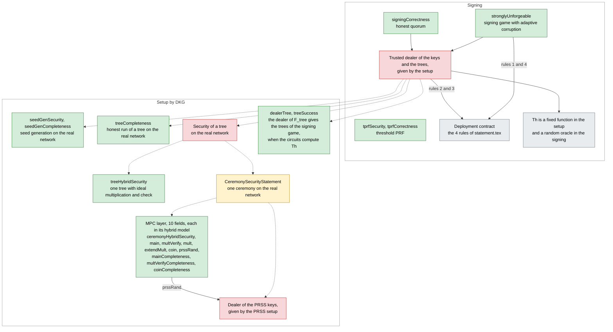

# formal

Lean 4 statements and proofs of security claims of threshold leanXMSS.

## The two main claims

The root theorem proves the bundle `Theorems`. Its 20 fields serve two main claims.

- The DKG acts as a trusted dealer of the keys and the trees. This claim is **not complete**. The seed generation is proved. The security of a ceremony and of a tree is proved in a hybrid model. On the real network, the ceremony claim is stated and not proved, and no claim covers a tree.
- The signing with that dealer is correct and strongly unforgeable. This claim is proved.

## The claims

The sections follow the note of leanXMSS, [doc/leanXMSS.pdf](../doc/leanXMSS.pdf). A ceremony is one MPC run, and a tree is the run of all ceremonies of one tree. A claim name gives the unit and then the property.

The claims are stated in the paper model of the protocol, in the random-oracle model. The setup claims take `Th` as one fixed function. Only `dealerTree` and `treeSuccess` assume that the circuits compute `Th`. The axiom guard of the root theorem lists only `propext`, `Classical.choice` and `Quot.sound`, and it covers the claims of the bundle only.

### The setup by DKG

The target is the trusted dealer `KeyGen` of PRAWNS (the note, Section 2.1). The setup has two protocols, the seed generation and the run of a tree. This claim is **not complete**.

| | Completeness | Security |
| --- | --- | --- |
| Seed generation | `seedGenCompleteness`, proved | `seedGenSecurity`, proved, on the real network |
| A tree | `treeCompleteness`, proved | `treeHybridSecurity`, proved, with ideal multiplication and check. No claim on the real network. |

- `dealerTree` and `treeSuccess` link the dealer of the tree functionality to the key generation of the signing game. Both are proved.
- `F_tree` leaks the openings of all batches of its dealer, so the chain values of the signature have no secrecy after an abort.
- The keygen ceremony of the note is the seed generation, then the ceremony of the top tree. A bottom tree has two ceremonies, one for the tree and one for the signature of its root.
- No claim is for Section 2.2 of the note, the setup by a trusted dealer with $n = 3f + 1$. Each claim is for $n = 2t - 1$.

### The signing

- `tprfCorrectness` and `tprfSecurity` cover the threshold PRF `F` (the note, Section 2, and PRAWNS, Definitions 2.1 and 2.2). Both are proved.
- `signingCorrectness` and `stronglyUnforgeable` cover the signing (the note, Section 2.3, and PRAWNS, Definition 3.2). Both are proved. The dealer of the signing game is `dealerKeyGen`.

### The MPC layer

The security of a ceremony rests on these ten proved fields. The note has no section for them, and Appendix C of [statement.tex](./statement.tex) states them.

- `ceremonyHybridSecurity` covers one ceremony with ideal multiplication and check, not on the real network.
- `coin`, `mult`, `extendMult`, `multVerify` and `main` are the building blocks of Goyal and Song. `coinCompleteness`, `multVerifyCompleteness` and `mainCompleteness` are their honest runs.
- `prssRand` covers the random sharings from PRSS keys of a dealer. No proved claim covers the PRSS setup.

## What is not proved

- No claim covers a tree on the real network. `CeremonySecurityStatement`, for one ceremony on the real network, is stated and not proved, and it is no part of the bundle.
- No proved claim covers the PRSS setup or joins the building blocks to the PRSS.
- No theorem composes the setup and the signing.
- [statement.tex](./statement.tex), Section 5, and [doc/composition.md](./doc/composition.md) give the open points.

## Map of the claims

<!-- Update this map when a field of the bundle changes or a claim is proved. Also update it when a
red box gets a claim or a hybrid model changes. -->

Green is proved, yellow is stated and not proved, red has no statement, and grey is an assumption. A solid arrow points to the trusted party or the assumption that a claim uses, and no theorem joins the two. A dashed arrow points to a part of an open claim.



| Open box | Reason |
| --- | --- |
| Dealer of the PRSS keys | The proof of the seed generation, the same protocol, needs a port to the PRSS setup. |
| Security of a tree on the real network | It needs `CeremonySecurityStatement` and the join of the layers, and both are open. |
| `CeremonySecurityStatement` | No composition theorem fits the proved claims, and a direct proof has open steps. |
| Trusted dealer of the keys and the trees | The composition of the setup and the signing is a sketch. |

No open box comes from a known attack.

## Details

| File | Content |
| --- | --- |
| [doc/differences.md](./doc/differences.md) | Each difference to GS20, PRAWNS, the note and leanXMSS |
| [doc/mpc-layer.md](./doc/mpc-layer.md) | The ceremony claims, the building blocks of GS20 and the PRSS streams |
| [doc/composition.md](./doc/composition.md) | The sketch of the composition and the gaps of the Rust code |

## Key files

- [Statement/Theorems.lean](./ThresholdLeanXmss/Statement/Theorems.lean) is the bundle of the claims and the model. It is the entry file of the folder `Statement/` that a reviewer reads.
- [ThresholdLeanXmssSecurity.lean](./ThresholdLeanXmssSecurity.lean) is the root theorem and the route of its proof.

```sh
cd formal
lake build   # build every module and check the axiom guards of the root file
```
