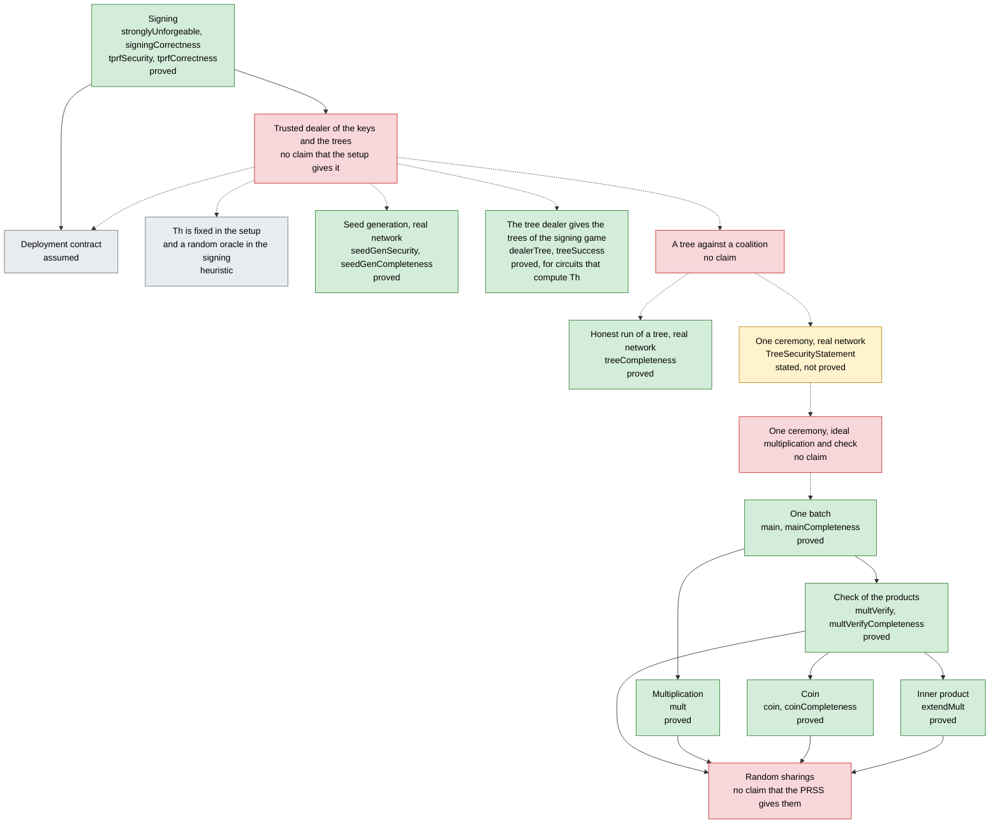

# formal

Lean 4 statements and proofs of security claims of threshold leanXMSS.

## The two main claims

The root theorem proves the bundle `Theorems`. Its 17 fields serve two main claims.

- The DKG acts as a trusted dealer of the keys and the trees. This claim is **not complete**. The seed generation is proved, and the security of a ceremony is stated and not proved.
- The signing with that dealer is correct and strongly unforgeable. This claim is proved.

## The claims in the order of the note

The sections follow the order of the note of leanXMSS, [doc/leanXMSS.pdf](../doc/leanXMSS.pdf). Each claim names its item of a source.

| Section | Source | Lean claims | State |
| --- | --- | --- | --- |
| 1. The scheme | The note, Section 1 | The definitions of leanXMSS, reused from leanVM | |
| 2. The threshold PRF `F` | The note, Section 2. PRAWNS, Definitions 2.1 and 2.2 | `tprfCorrectness`, `tprfSecurity` | Proved |
| 3. The setup by DKG | The note, Section 2.1. The target is the trusted dealer `KeyGen` of PRAWNS | | **Not complete** |
| 3.1 The keygen ceremony | The seed generation, then the ceremony of the top tree | `seedGenSecurity`, `seedGenCompleteness`. For the top tree, `TreeSecurityStatement`, `treeCompleteness` and `dealerTree`. | Seed generation proved. Security of the ceremony of the top tree stated and not proved. Honest run and dealer claim of the top tree proved. |
| 3.2 Each bottom tree | Two ceremonies, one for the bottom tree and one for the signature of its root | `TreeSecurityStatement`, `treeCompleteness`, `dealerTree`, `treeSuccess` | Security of each ceremony stated and not proved. Honest run and dealer facts proved. |
| 3.3 The MPC protocol | Goyal and Song | `coin`, `mult`, `extendMult`, `multVerify`, `main`, and the honest runs | Proved |
| 4. The signing | The note, Section 2.3. PRAWNS, Definition 3.2 | `signingCorrectness`, `stronglyUnforgeable` | Proved |

These facts complete the table.

- `TreeSecurityStatement` is stated and not proved, and it is no field of the bundle.
- `treeCompleteness` and `dealerTree` cover the top tree and each bottom tree with the signature of its root.
- The eight fields of section 3.3 are lemmas on the building blocks of the DKG. The honest-run claims are `coinCompleteness`, `multVerifyCompleteness` and `mainCompleteness`.
- The threshold PRF of section 2 serves the signing of section 4.
- The note has no section for the MPC protocol. It names the MPC in its Section 2.1.
- No section is for Section 2.2 of the note, the setup by a trusted dealer with $n = 3f + 1$. Each claim is for $n = 2t - 1$, and the dealer of the signing game is `dealerKeyGen`.

## What is proved

- The seed generation is secure with selective abort against a static coalition.
- The threshold PRF is secure against an adaptive coalition.
- The signing is strongly unforgeable with adaptive corruption.
- The building blocks of the DKG are secure, and each honest run gives its output, except with the failure probability that its claim names.
- The honest ceremonies of a tree give the tree of its dealer, except with the failure probability that its claim names. When the circuits compute `Th`, that dealer gives the trees of the signing claim.

The claims are stated in the paper model of the protocol, in the random-oracle model. The seed generation and ceremony claims take `Th` as one fixed function. Only `dealerTree` and `treeSuccess` assume that the circuits compute `Th`.

The axiom guard of the root theorem lists only `propext`, `Classical.choice` and `Quot.sound`. It covers the claims of the bundle only.

## What is not proved

One important claim has no proof. `TreeSecurityStatement` says that one ceremony of the DKG is secure with selective abort. It is stated and not proved, and it is no part of the bundle.

So the first main claim is proved for the seed generation and for the building blocks. It is not proved for a ceremony.

No claim composes the seed generation, the ceremonies and the signing. Each claim covers one protocol or one building block alone. So no theorem composes the DKG with the signing, and no claim joins the two ceremonies of a bottom tree. [statement.tex](./statement.tex) holds a sketch of the composition, with its open points.

What is claimed, and what is not, is [statement.tex](./statement.tex).

## Map of the claims

<!-- Update this map when a field of the bundle changes or a claim is proved. Also update it when a
red box gets a claim or a hybrid model changes. -->

The map shows each part of the protocol and the state of its claim. The goal is a map with no yellow box and no red box.

- Green is proved. Yellow is stated and not proved. Red has no claim. Grey is an assumption that no theorem closes.
- A solid arrow from A to B says that the claim of A takes B as a trusted party or as an assumption.
- A dashed arrow from A to B says that B is a part of the open claim A.
- No proof uses the proof of another box. Each of the 17 fields of the bundle is in one box.



| Box that is not green | What closes it |
| --- | --- |
| One ceremony, ideal multiplication and check | A claim for all batches of a ceremony. `main` has it for one batch. |
| Random sharings | A claim that the PRSS gives the random sharings. The coin, the multiplication, the inner product and the check take them from a trusted party. |
| One ceremony, real network | A proof of `TreeSecurityStatement`, with the real building blocks and the real PRSS. |
| A tree against a coalition | A claim for the two ceremonies of a bottom tree together, with the local steps between them. |
| Trusted dealer of the keys and the trees | A composition of the seed generation, the trees and the signing. |

The map covers the model. No theorem connects the Rust code to the model. [statement.tex](./statement.tex), Section 5, lists each open point and what no claim covers.

## Key files

- [Statement/Theorems.lean](./ThresholdLeanXmss/Statement/Theorems.lean) is the bundle of the claims and the model. It is the entry file of the folder `Statement/` that a reviewer reads.
- [ThresholdLeanXmssSecurity.lean](./ThresholdLeanXmssSecurity.lean) is the root theorem and the route of its proof.

```sh
cd formal
lake build   # build every module and check the axiom guards of the root file
```
