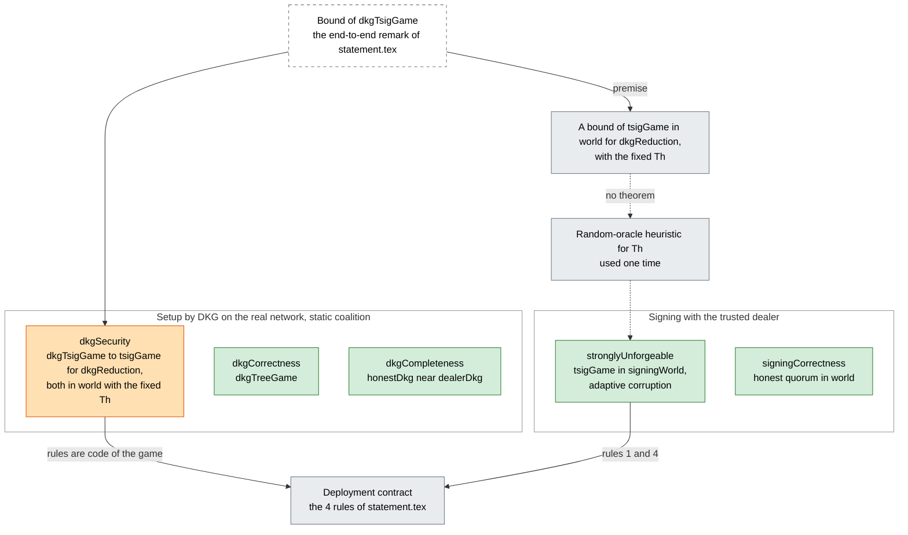

# formal

Lean 4 statements and proofs of the security claims of threshold leanXMSS. The two signing claims, `dkgCorrectness` and `dkgCompleteness` are proved. The claim `dkgSecurity` is stated. Its cost bound is proved, and no proof of its bound on the win probability is in this tree.

## The claims

The structure `Theorems` in [Statement/Theorems.lean](./ThresholdLeanXmss/Statement/Theorems.lean) has five fields. Each field is a game with a fixed bound. [statement.tex](./statement.tex) is the guide to the claims.

| Field | Claim | Model in the papers | Bound |
| --- | --- | --- | --- |
| `stronglyUnforgeable` | Signing with a trusted dealer is strongly unforgeable with adaptive corruption. | PRAWNS, Definition 3.2 | Proved, `SigningStronglyUnforgeable.stronglyUnforgeable` |
| `signingCorrectness` | An honest quorum signs, except for a failed search. | PRAWNS, Section 3.1 | Proved, `signingCorrectness` |
| `dkgSecurity` | An adversary against the signing game with the real DKG wins at most as often as the named forger `dkgReduction` wins the signing game with the dealer, plus a fixed error. | Gurkan and others, Definition 8 | The cost bound of the forger is proved, `DkgSecurityProof.dkgReduction_cost`. The bound on the win probability is a target. `DkgSecurityProof.dkgSecurity_of_leaves` gives the field from two hops and two parts of the first hit with no proof yet. Its error `dkgError` is the sum of the errors of the hops of the proof. |
| `dkgCorrectness` | Against an adversary, honest operators hold consistent seeds, and each tree output is right or absent. | Gurkan and others, Definition 6 | Proved, `dkgCorrectness` |
| `dkgCompleteness` | With no corrupt operator, the DKG gives outputs that are near the outputs of the dealer. | None | Proved, `dkgCompleteness` |

The four proved theorems are in the namespace `ThresholdLeanXmssSecurity`. The bound of `dkgSecurity` on the win probability is a target with no proof for the whole game yet, so a proof can change it. The coalition of the DKG is static, and the signing game has adaptive corruption. The claims of the DKG fix the function `Th`, and `stronglyUnforgeable` has `Th` in the random oracle.

## Map of the claims

<!-- Update this map when a field of the bundle changes or a claim is proved. -->

Green is proved in this tree. Orange is stated with a target bound. Grey is an assumption. The dashed box has no Lean statement.



| Box | Reason |
| --- | --- |
| Bound of `dkgTsigGame` | A bound δ on the success of `dkgReduction` in `tsigGame` in `world` with the fixed `Th` gives δ plus `dkgError` plus `streamAdvantage` for `dkgTsigGame`. No field gives such a δ, and no small δ holds for each query-bounded adversary with a fixed `Th`. To take the bound of `stronglyUnforgeable` for δ, for an adversary that makes no search on `Th`, is the random-oracle heuristic for `Th`. |

## Files

| File | Content |
| --- | --- |
| [ThresholdLeanXmss/Statement/Theorems.lean](./ThresholdLeanXmss/Statement/Theorems.lean) | The bundle `Theorems` and the model. The entry file. |
| [ThresholdLeanXmss/Statement/Signing.lean](./ThresholdLeanXmss/Statement/Signing.lean) | `tsigGame` and the two signing claims |
| [ThresholdLeanXmss/Statement/DkgGame.lean](./ThresholdLeanXmss/Statement/DkgGame.lean) | `dkgTsigGame`, `dkgTreeGame`, `honestDkg` and `dealerDkg` |
| [ThresholdLeanXmss/Statement/Dkg.lean](./ThresholdLeanXmss/Statement/Dkg.lean) | `CircuitsCompute` and the three claims of the DKG, with their adaptations of the papers |
| [ThresholdLeanXmss/Statement/DkgErrors.lean](./ThresholdLeanXmss/Statement/DkgErrors.lean) | The error and cost terms of the three claims of the DKG |
| [ThresholdLeanXmss/Statement/DkgReduction.lean](./ThresholdLeanXmss/Statement/DkgReduction.lean) | `dkgReduction`, the named forger of `dkgSecurity` |
| [ThresholdLeanXmss/Statement/RandomOracle.lean](./ThresholdLeanXmss/Statement/RandomOracle.lean) | `world`, `signingWorld` and the count of the calls |
| [ThresholdLeanXmss/Statement/Execution.lean](./ThresholdLeanXmss/Statement/Execution.lean) | The execution of a protocol on the network |
| [ThresholdLeanXmss/Scheme.lean](./ThresholdLeanXmss/Scheme.lean) | The protocol, the oracles and the dealer `dealerKeyGen` |
| [ThresholdLeanXmss/Ideal.lean](./ThresholdLeanXmss/Ideal.lean) | The oracles of the signing game and its win test |
| [ThresholdLeanXmss/Reductions.lean](./ThresholdLeanXmss/Reductions.lean) | `prgReduction`, the fixed reduction of the PRF term |
| [ThresholdLeanXmssSecurity.lean](./ThresholdLeanXmssSecurity.lean) | The root of the proof library. It imports the proof of each proved field and checks the axioms of each proved theorem with `#guard_msgs`. |
| [ThresholdLeanXmssSecurity/Proof/](./ThresholdLeanXmssSecurity/Proof/) | The proofs |
| [ThresholdLeanXmssSecurity/Base/](./ThresholdLeanXmssSecurity/Base/) | The definitions that the proofs use and that the statement layer does not hold |
| [statement.tex](./statement.tex) | The guide to the claims, about 12 pages |
| [doc/model.md](./doc/model.md) | The model of the five claims |
| [doc/differences.md](./doc/differences.md) | Each difference to GS20, PRAWNS, the note, leanXMSS and Gurkan and others |

## Build

```sh
cd formal
lake build   # build both default targets, ThresholdLeanXmss and ThresholdLeanXmssSecurity
```

The root module of the proof library fails the build unless each proved theorem depends only on `propext`, `Classical.choice` and `Quot.sound`.
